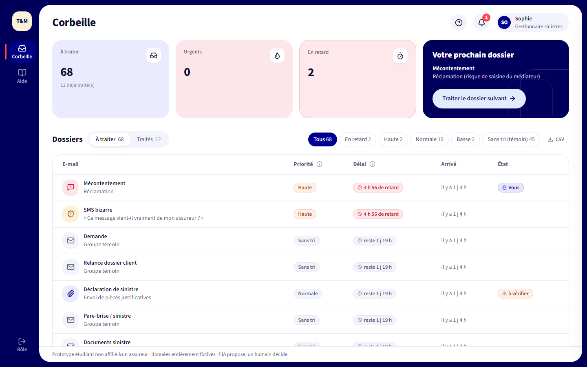
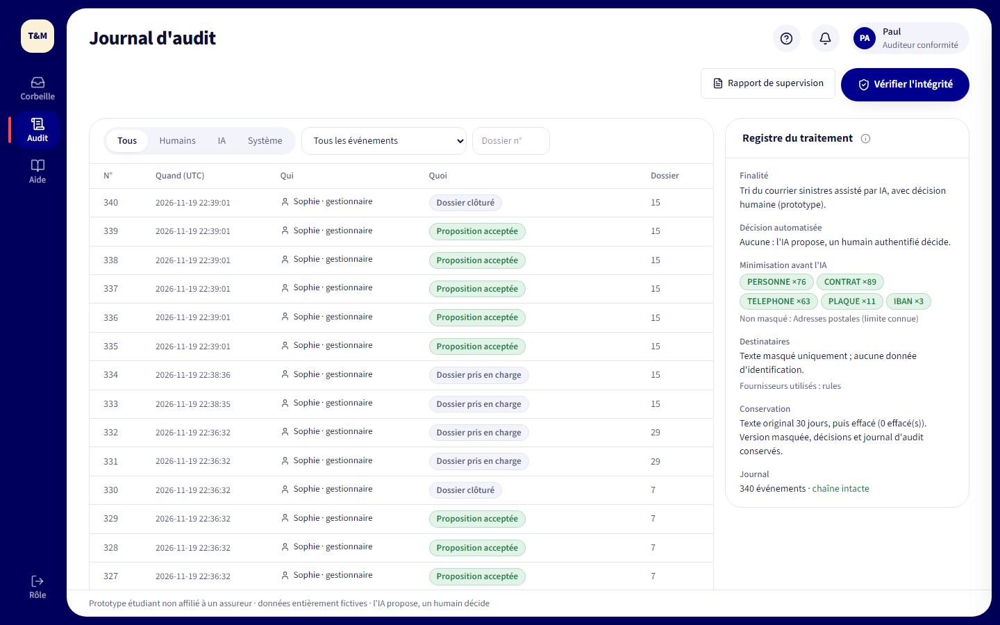

# Tri & Mesure

**Un outil pour traiter le courrier sinistres avec l'IA, et prouver ce qu'elle apporte.**
L'IA propose, un humain décide, l'outil mesure.

[](https://montassartantouch.me/demo/tri-et-mesure-demo.mp4)

> Prototype étudiant, non affilié à un assureur. Toutes les données sont fictives.

## Le problème

Un assureur reçoit chaque jour des milliers d'e-mails : déclarations de sinistre, relances,
réclamations, pièces justificatives. L'IA peut aider à les trier, mais une question reste
ouverte : **fait-elle vraiment gagner du temps, sans erreurs, et pour quel coût ?**

## Ce que fait l'outil

1. **L'IA propose** : pour chaque e-mail, une catégorie, les informations clés (n° de
   contrat, date, type de dommage…) et un résumé. Chaque valeur renvoie à la phrase de
   l'e-mail qui la justifie.
2. **Le gestionnaire décide** : il vérifie, corrige ou rejette, puis valide. Rien n'est
   appliqué sans lui.
3. **L'outil mesure** : la moitié des dossiers est traitée sans IA (groupe témoin). La
   comparaison montre le vrai gain de temps et de justesse.

## Pour qui

| Rôle | Ce qu'il voit |
|---|---|
| **Gestionnaire sinistres** | Sa corbeille (les plus urgents d'abord) et chaque dossier : l'e-mail, la proposition de l'IA, le contrat, une réponse type |
| **Responsable d'équipe** | Le stock, les retards, le gain mesuré de l'IA, et un « mode tempête » pour simuler un afflux d'e-mails |
| **Auditeur conformité** | Le journal de toutes les actions, impossible à modifier sans que cela se voie |
| **Équipe IA** | La comparaison de plusieurs IA sur les mêmes dossiers, et une alerte si leur qualité baisse |

| Corbeille | Pilotage | Journal d'audit |
|---|---|---|
|  |  |  |

## Ce qui est garanti (et testé)

- **Données personnelles masquées** avant tout appel à l'IA : noms, téléphones, e-mails,
  IBAN, n° de sécurité sociale, plaques, n° de contrat. *Limite connue : les adresses
  postales ne sont pas encore masquées.*
- **Un humain décide toujours** : aucun dossier n'est clos sans un gestionnaire connecté.
- **Journal infalsifiable** : chaque action est chaînée à la précédente, et la base refuse
  toute modification ou suppression.
- **L'équipe n'est jamais bloquée** : si l'IA est en panne ou hors budget, des règles
  simples prennent le relais.

## Essayer en local

```bash
cp .env.example .env          # fonctionne sans clé d'IA (mode « règles »)
docker compose up -d db
pnpm install && pnpm api:sync
pnpm db:migrate
pnpm dev                      # puis ouvrir http://localhost:5173
```

Choisissez un rôle, puis « Charger 80 e-mails de démo ».

## Comment c'est construit

React + TypeScript · FastAPI (Python) · PostgreSQL · Claude ou toute IA compatible OpenAI ·
Docker · GitHub Actions (lint, types, 94 tests) · AWS en Terraform (CloudFront, EC2).

Pour aller plus loin : [documentation](docs/README.md) (rôles, architecture, sécurité,
exploitation, décisions) · [déploiement AWS](docs/deployment-aws.md) ·
[refaire la vidéo de démo](tools/demo/README.md).
