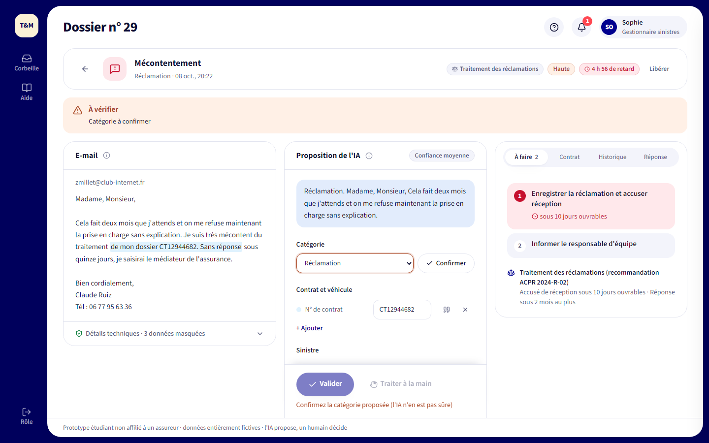
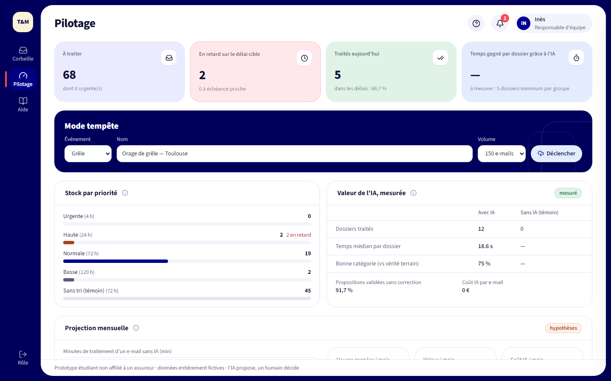

# Tri & Mesure

> Prototype étudiant non affilié à un assureur. Données entièrement synthétiques.

**L'arbitre neutre des IA du courrier sinistres.** Les assureurs achètent déjà de l'IA qui
trie et répond, souvent à plusieurs fournisseurs. Personne de neutre ne répond à la question
suivante : *sur les mêmes dossiers, quelle IA aide vraiment, pour quel coût, et devient-elle
moins bonne ?* Tri & Mesure est cette couche de contrôle : l'IA propose, un humain décide,
l'outil mesure — et n'importe quelle IA peut s'y brancher.

## Démo

- **Vidéo (1 min 37)** : [docs/demo/demo.webm](docs/demo/demo.webm) — les quatre rôles, de bout en bout.
- **En ligne** : <https://dlql7mqscfieg.cloudfront.net> (serveur allumé sur demande pour limiter les coûts).



| Corbeille | Pilotage | Journal d'audit |
|---|---|---|
|  |  |  |

## En 30 secondes

| Rôle | Écran | Ce qu'il fait |
|---|---|---|
| Gestionnaire | Corbeille → Dossier | « Traiter le dossier suivant », vérifier la proposition, valider (Ctrl + Entrée) |
| Responsable | Pilotage | Stock, retards, gain **mesuré** (groupe témoin), **mode tempête** |
| Auditeur | Journal d'audit | Chaîne d'empreintes vérifiable, registre, **rapport de supervision scellé** |
| Équipe IA | Contrôle des IA | **Tour de contrôle** (champion / fantômes, score sans biais), examen, **alertes de dérive** |

## Ce qui est garanti, et testé

- Aucune donnée personnelle identifiante n'est envoyée au modèle : masquage avant chaque appel.
- Aucun dossier n'est clos sans un humain authentifié. Un seul gestionnaire à la fois, une
  seule décision par dossier.
- Le journal d'audit est chaîné, et la base refuse toute modification ou suppression.
- Une panne ou un dépassement de budget du modèle n'arrête pas l'équipe : file
  asynchrone, nouvel essai, puis repli sur des règles.
- Une IA externe se branche avec une clé d'API, ne reçoit que du texte masqué, et est notée
  sans biais sur les dossiers du groupe témoin.
- Les couches du code ne peuvent pas se mélanger (vérifié en CI).

## Démarrer

```bash
cp .env.example .env          # LLM_PROVIDER=rules fonctionne sans clé
docker compose up -d db
pnpm install && pnpm api:sync
pnpm db:migrate
pnpm dev                      # API :8000 · web :5173
```

Choisissez un rôle, puis « Charger 80 e-mails de démo ». Pour brancher un faux
fournisseur : écran « Contrôle des IA » → « Créer la clé », puis
`pnpm vendor -- --key tm_… --noise 0.35`.

## Stack

React 19 · TypeScript · TanStack Router/Query · Tailwind — FastAPI · Pydantic v2 ·
SQLAlchemy 2 (async) · PostgreSQL 16 — JWT · RFC 9457 · Prometheus · structlog — Claude
ou tout fournisseur compatible OpenAI, derrière une passerelle — Docker · GitHub Actions
(lint, types, contrats d'architecture, tests SQLite + PostgreSQL, évaluation du modèle) ·
AWS en Terraform (CloudFront, EC2 Graviton, ECR, SSM, CloudWatch) — voir
[docs/deployment-aws.md](docs/deployment-aws.md).

## Documentation

[docs/](docs/README.md) : acteurs, architecture (C4, séquences, états, données), UX, qualités,
sécurité, exploitation, décisions.
