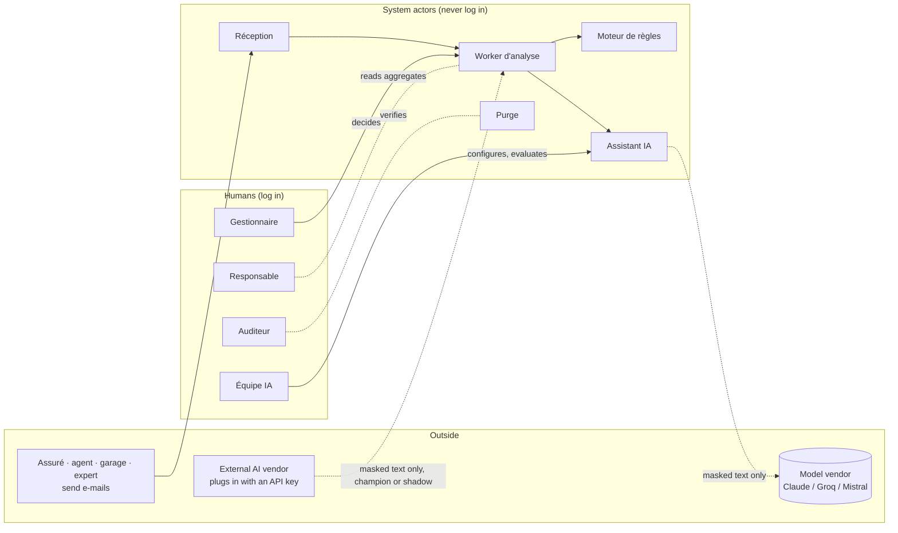

# Actors and roles

The source of truth is [`domain/roles.py`](../apps/api/src/tri_mesure/domain/roles.py). The
API guards, the navigation in the UI and this page all derive from it.

## Who is involved

| Actor | Kind | Does | Never does |
|---|---|---|---|
| **Gestionnaire sinistres** | human | Takes a case, checks the AI proposal, accepts / corrects / rejects, closes | Sees the AI output on control-arm cases before closing |
| **Responsable d'équipe** | human | Reads stock, deadlines, flow and the measured value of the AI; edits assumptions | Sees per-person timing or rankings |
| **Auditeur conformité** | human | Reads the audit log, verifies integrity, reads the processing register | Changes anything |
| **Équipe IA** | human | Runs offline evaluations, reads production quality, changes model or prompt (audited) | Decides on a case |
| Réception (`system:intake`) | system | Stores the e-mail, masks personal data, queues it | Calls the model |
| Worker (`system:worker`) | system | Claims queued e-mails, runs the pipeline, retries, flags failures | Blocks intake when the model is slow |
| Moteur de règles (`system:rules`) | system | Computes priority from extracted facts, with reasons | Uses the LLM |
| Purge (`system:retention`) | system | Erases original text after the retention period | Touches the audit log |
| Assistant IA (`ai:<model>`) | system | Proposes category, fields, summary, evidence | **Decides anything** |
| External AI vendor (`ai:<source>`) | machine, API key | Fetches open cases (masked), posts proposals: shown if champion, scored in shadow otherwise | Sees identities, human decisions or other vendors' answers |

## Permissions

| Permission | Gestionnaire | Responsable | Auditeur | Équipe IA |
|---|:-:|:-:|:-:|:-:|
| `cases.read`: queue and case files | ✅ | ✅ | ✅ | ✅ |
| `cases.review`: take a case, decide | ✅ | | | |
| `pilotage.read`: team dashboard | | ✅ | | |
| `assumptions.write`: business assumptions | | ✅ | | |
| `audit.read`: log, integrity, register | | | ✅ | |
| `eval.read` / `eval.run`: evaluation | | | | ✅ |
| `config.write`: model, prompt | | | | ✅ |
| `demo.seed`: load demo data | ✅ | ✅ | | ✅ |
| `crisis.manage`: declare a climate event | | ✅ | | |

Separation of duties: the person who configures the model cannot decide on cases. The
person who decides cannot change the model. The auditor has read-only access.

## Two deliberate choices

- **No individual tracking.** The dashboard shows team aggregates only. Measuring the AI
  must not become measuring people. In an insurance company this also matters for
  employee representatives.
- **Every action has an author.** The audit actor of a human comes from the signed token,
  never from a free-text field. System actors have stable names.
