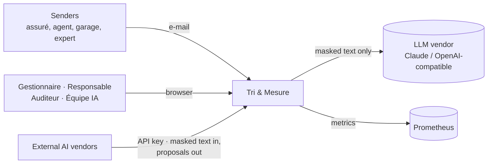
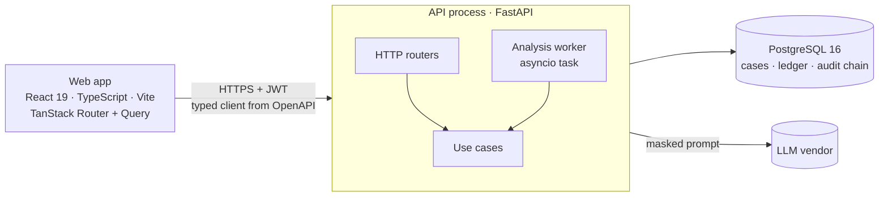
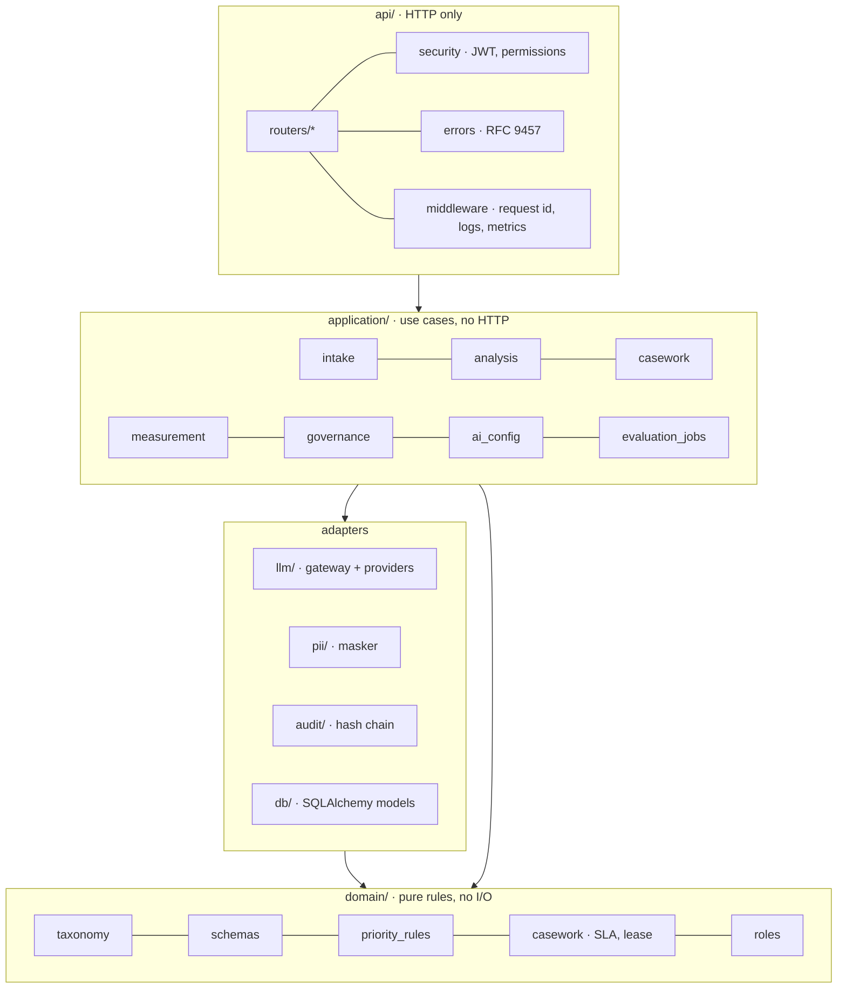
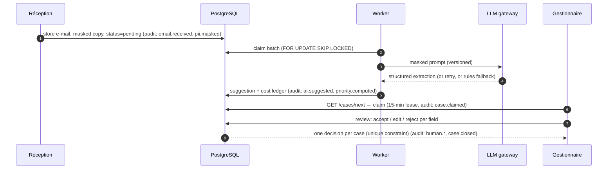
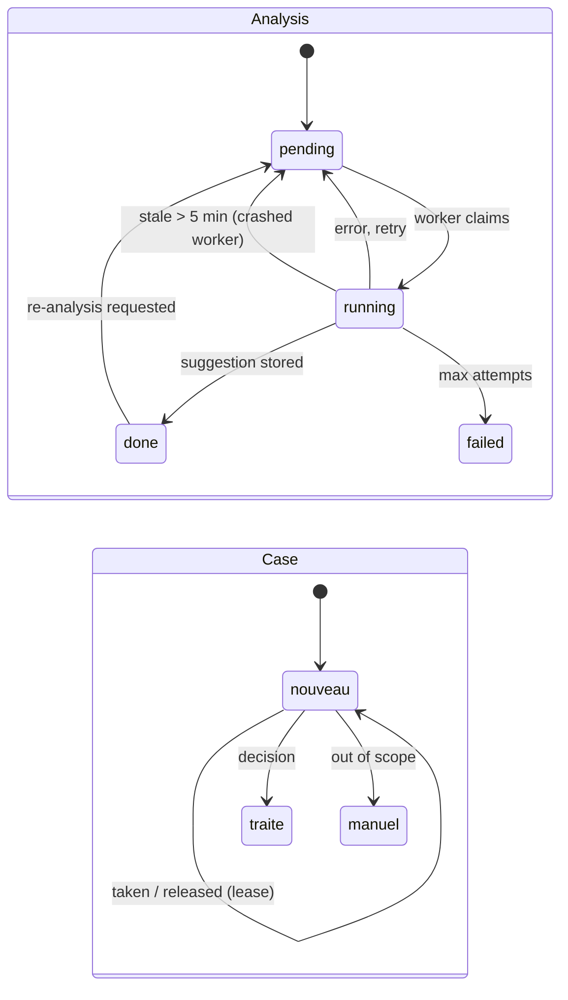
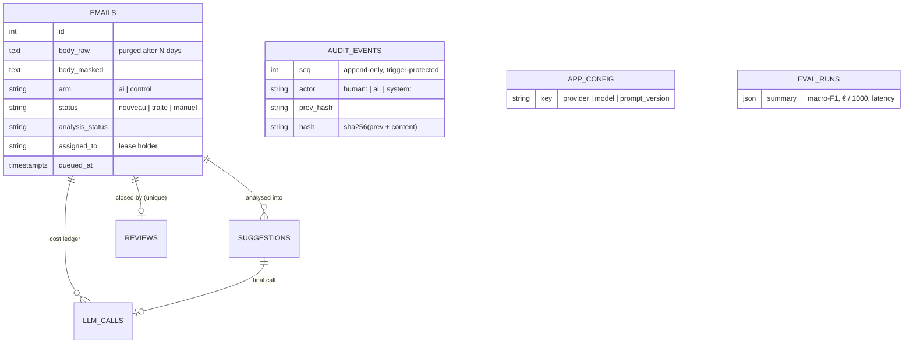

# Architecture

Four levels of zoom (C4), then the two flows and the data model. One rule throughout:
**the AI proposes, a human decides, everything is measured and traced.**

## 1. Context

## 2. Containers

The worker runs inside the API process for simplicity. It claims work with
`FOR UPDATE SKIP LOCKED`, so it can be moved to its own container, or scaled to N
replicas, without code changes ([ADR 0005](decisions/0005-asynchronous-analysis-worker.md)).

## 3. Components (inside the API)

Dependencies point **inwards only**. [import-linter](../apps/api/pyproject.toml) checks
this in CI, and the build fails if a layer leaks.

| Layer | May import | Must not import | Checked by |
|---|---|---|---|
| `domain` | stdlib, pydantic | anything else in the app, FastAPI, SQLAlchemy, vendor SDKs | import-linter |
| `application` | domain, adapters | `api`, FastAPI, Starlette | import-linter |
| adapters (`llm`, `pii`, `audit`) | domain | `api`, `application` | import-linter |
| vendor SDKs (`anthropic`, `openai`) | only `llm/*_provider.py` | everywhere else | import-linter |

## 4. Flows

### An e-mail, from arrival to decision

### State machines

## 5. Data model

## Where to look in the code

| Question | File |
|---|---|
| What can each role do? | `domain/roles.py` |
| How is priority decided? | `domain/priority_rules.py` |
| Deadlines and leases? | `domain/casework.py` |
| What is sent to the model? | `pii/masker.py`, `llm/prompts/v1.md`, `llm/gateway.py` |
| How does the worker avoid double work? | `application/analysis.py` (`claim_batch`) |
| How is a decision recorded? | `application/casework.py` (`submit_review`) |
| How is the gain measured? | `application/measurement.py` (`pilotage`) |
| How is tampering detected? | `audit/chain.py`, migration `0001` (trigger) |
| How does an external AI plug in? | `api/routers/ingest.py`, `application/sources.py`, `tools/vendor_sim.py` |
| How is a vendor scored without bias? | `application/sources.py` (`scoreboard`) |
| Storm mode? | `application/crisis.py`, `datagen/generate.py` (`generate_storm`) |
| Drift alarm? | `application/monitoring.py` |
| Oversight report? | `application/governance.py` (`oversight_report`) |
