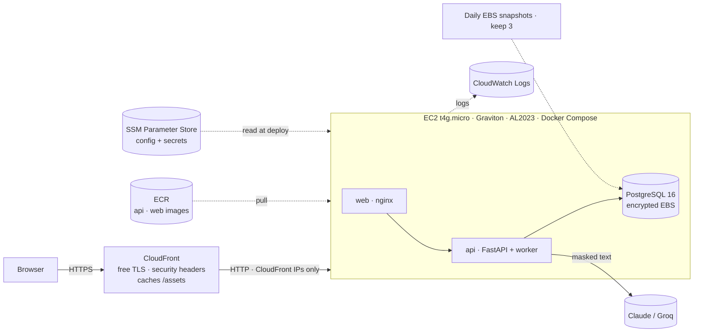

# Deployment on AWS

Lean and real: a single small server, managed services around it, everything in code
(`infra/aws/`, Terraform). Region `eu-west-3` (Paris), so the data stays in France.



| Concern | Choice | Why |
|---|---|---|
| HTTPS | CloudFront default certificate (`*.cloudfront.net`) | Free TLS without buying a domain; HSTS and security headers via the managed policy |
| Exposure | Security group open on port 80 **only** to CloudFront's managed prefix list; no SSH | The server cannot be reached directly from the internet |
| Admin access | SSM Session Manager | No port 22, no keys, every session in CloudTrail |
| Secrets | SSM Parameter Store `SecureString` (KMS), generated by Terraform | Nothing secret in the image, the repo or user data |
| Instance metadata | IMDSv2 required, hop limit 2 | SSRF protection, still usable from containers |
| CPU credits | `standard` mode | T4g "unlimited" mode bills surplus CPU silently |
| Logs | Docker `awslogs` driver → CloudWatch, 14-day retention | Search by `request_id` after an incident |
| Backups | Data Lifecycle Manager: daily snapshot, keep 3 | Restore PostgreSQL by restoring the volume |
| Cost | Optional AWS Budget alert (`budget_alert_email`) | No surprise bill |

## Cost (eu-west-3, approximate, before credits)

| Item | Running 24/7 | Stopped |
|---|---|---|
| EC2 t4g.micro | ~6.5 $ | 0 |
| Public IPv4 (Elastic IP) | ~3.7 $ | ~3.7 $ |
| EBS gp3 20 GB + snapshots | ~2 $ | ~2 $ |
| CloudFront, ECR, SSM, CloudWatch | ~0 $ (free tiers at demo volume) | 0 |
| **Total** | **~12 $ / month** | **~6 $ / month** |

Stop the server between demos (`pnpm aws:stop`), and start it 2 minutes before showing it
(`pnpm aws:start`). Destroy everything with `terraform destroy`.

## First deployment

```bash
aws sso login                                  # session for the default profile
cd infra/aws
terraform init
TF_VAR_anthropic_api_key=... terraform apply   # keys optional; read from your shell, never committed
cd ../.. && pnpm aws:deploy                    # build ARM64 images, push to ECR, redeploy via SSM
```

`pnpm aws:deploy` prints the public link. Redeploy after every change with the same
command.

## Day-2

| Task | Command |
|---|---|
| Shell on the server | `aws ssm start-session --target $(terraform -chdir=infra/aws output -raw instance_id)` |
| Logs | CloudWatch → Log groups → `/tri-mesure/containers` (filter by `request_id`) |
| Change config | Edit `infra/aws/docker-compose.prod.yml` or a variable → `terraform apply` → `pnpm aws:deploy` |
| Rotate the API keys | `TF_VAR_anthropic_api_key=... terraform apply` → `pnpm aws:deploy` |

## Path to production (not needed for the demo)

Managed PostgreSQL (RDS, Multi-AZ), ECS Fargate behind an ALB with autoscaling, a custom
domain with ACM, AWS WAF on CloudFront, GitHub Actions deploying via OIDC, and Terraform
state in S3. The application needs no change for any of these: the same images, the
same environment variables.
